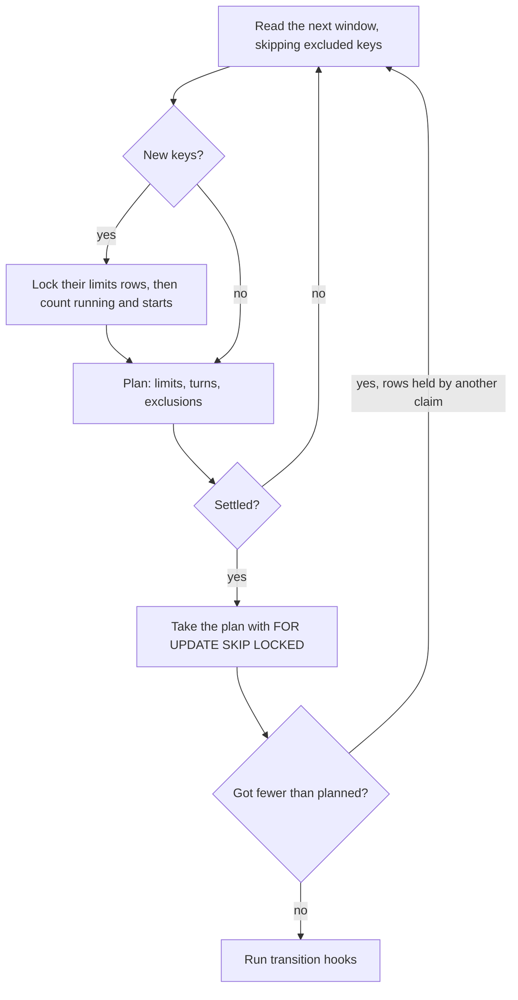

# How a claim works

A claim picks up to `slots` jobs from one queue, in order, while respecting limits and, in fair mode, the turn of each `limit_key` group. It runs in its own transaction per queue.

## Reading the queue in windows

The claim reads ready rows through the index `(queue, priority DESC, run_at, id) WHERE state = 'queued'` in windows: the first is `slots × 4` rows, each next one twice as large. After each window a planner decides, in Python, whether any unread row could still change the result. If not, it stops.

Two kinds of rows are left out of the next window:

- **Keys at their limit.** A key with `n` starts left takes its first `n` rows; the rest of that key is skipped for the rest of the claim.
- **Fair groups that cannot win a slot.** The group's next turn is later than the last turn the claim needs, or it already has `slots` rows planned.

The plan is the same as ranking the whole queue at once; this was checked against the old full-scan query on 3 520 random queues with no differences.

## Locks

A claim locks the limits rows of the keys it considers, then counts running jobs and starts in a new statement, so two workers cannot both see a free slot for the same key. Only the first lock may wait; once a claim holds a limits row or a job, further keys are locked with `SKIP LOCKED`, and a key another claim holds waits for the next claim. Two claims that meet keys in a different order therefore do not deadlock.

## Speed

!!! note
    The windowed claim is on `main` and ships in the first release after 0.5.0.

PostgreSQL 16, `slots = 20`, 100 000 ready jobs, median of 15 claims. "Before" is akadze 0.5.0, which ranked the whole queue in one statement whenever the head did not fill the claim, and always in fair mode.

| Queue | Order | 0.5.0 | Now |
|---|---|---|---|
| 20 000 keys × 5 jobs | fair | 313 ms | 2.6 ms |
| 200 of 400 groups busy | fair | 276 ms | 7.3 ms |
| 5 000 urgent jobs over 95 000 | fair | 255 ms | 4.6 ms |
| 1 000 keys at their limit, then free ones | fair | 252 ms | ~15 ms |
| 1 000 keys at their limit, then free ones | default | 201 ms | ~14 ms |
| 50 keys, one with a deep backlog | fair | 190 ms | 4.3 ms |
| first 50 000 jobs: one key at its limit | default | 187 ms | 5.7 ms |
| first 50 000 jobs: one key at its limit | fair | 159 ms | 4.2 ms |
| no keys, one group | fair | 120 ms | 17.9 ms |
| whole queue: one key at its limit | default | 93 ms | 16.1 ms |
| whole queue: one key at its limit | fair | 92 ms | 17.2 ms |

Under load, 10 concurrent claimers for 20 s on 20 000 jobs with 20 limited keys claimed 8 610 jobs in default order (2 796 before) and 5 387 in fair order (3 340 before), with no errors and no moment where a key ran over `max_running`.

The worst case is still linear: when the claim must read past every job (one group in fair mode, or a key at its limit holding the whole queue) it reads the index to the end, about 17 ms per 100 000 jobs.

Design notes, the rejected alternatives and the exactness argument: [akadze-harness](https://github.com/g4st3r-d3v/akadze-harness), note 15.
