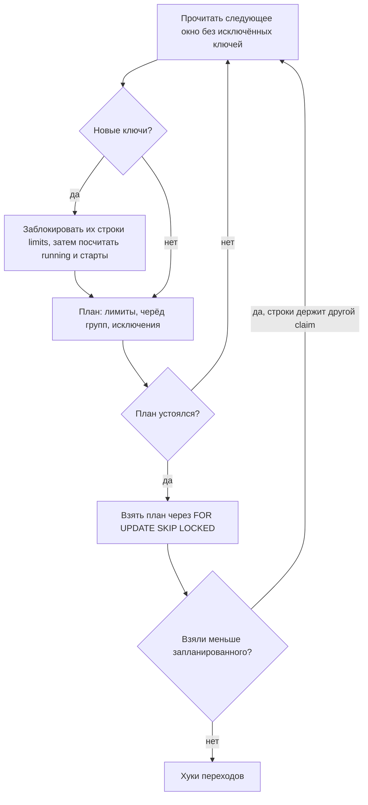

# Как работает claim

Claim выбирает из одной очереди до `slots` заданий по порядку, соблюдая лимиты и, в режиме fair, черёд каждой группы `limit_key`. Каждая очередь забирается в своей транзакции.

## Чтение очереди окнами

Claim читает готовые строки через индекс `(queue, priority DESC, run_at, id) WHERE state = 'queued'` окнами: первое — `slots × 4` строк, каждое следующее вдвое больше. После каждого окна планировщик в Python решает, может ли ещё какая-то непрочитанная строка изменить результат. Если нет — чтение останавливается.

Из следующего окна исключаются строки двух видов:

- **Ключи на лимите.** Ключ, у которого осталось `n` стартов, берёт свои первые `n` строк; остальные строки этого ключа пропускаются до конца claim.
- **Группы fair, которым слот не достанется.** Следующий черёд группы позже последнего, который нужен claim, или в плане у группы уже `slots` строк.

План совпадает с ранжированием всей очереди сразу. Это проверено против старого запроса с полным сканом на 3 520 случайных очередях: расхождений нет.

## Блокировки

Claim блокирует строки `limits` рассматриваемых ключей, а затем считает running и старты новым запросом, поэтому два воркера не могут оба увидеть свободный слот одного ключа. Ждать может только первая блокировка: когда claim уже держит строку `limits` или задание, следующие ключи блокируются через `SKIP LOCKED`, и ключ, занятый другим claim, ждёт следующего claim. Поэтому два claim, встречающие ключи в разном порядке, не попадают в deadlock.

## Скорость

!!! note
    Claim по окнам есть в `main` и выйдет в первом релизе после 0.5.0.

PostgreSQL 16, `slots = 20`, 100 000 готовых заданий, медиана 15 claim. «0.5.0» — версия, которая ранжировала всю очередь одним запросом, когда голова не заполняла claim, и всегда в режиме fair.

| Очередь | Режим | 0.5.0 | Сейчас |
|---|---|---|---|
| 20 000 ключей × 5 заданий | fair | 313 мс | 2,6 мс |
| 200 из 400 групп заняты | fair | 276 мс | 7,3 мс |
| 5 000 срочных над 95 000 | fair | 255 мс | 4,6 мс |
| 1 000 ключей на лимите, затем свободные | fair | 252 мс | ~15 мс |
| 1 000 ключей на лимите, затем свободные | обычный | 201 мс | ~14 мс |
| 50 ключей, у одного глубокий бэклог | fair | 190 мс | 4,3 мс |
| первые 50 000: один ключ на лимите | обычный | 187 мс | 5,7 мс |
| первые 50 000: один ключ на лимите | fair | 159 мс | 4,2 мс |
| без ключей, одна группа | fair | 120 мс | 17,9 мс |
| вся очередь: один ключ на лимите | обычный | 93 мс | 16,1 мс |
| вся очередь: один ключ на лимите | fair | 92 мс | 17,2 мс |

Под нагрузкой 10 параллельных claim в течение 20 с на 20 000 заданиях с 20 ключами под лимитом забрали 8 610 заданий в обычном режиме (было 2 796) и 5 387 в fair (было 3 340), без ошибок и без превышения `max_running` ни в один момент.

Худший случай по-прежнему линейный: когда claim должен прочитать всю очередь (одна группа в fair или ключ на лимите во всю очередь), он читает индекс до конца — около 17 мс на 100 000 заданий.

Заметки о дизайне, отвергнутые варианты и доказательство точности: [akadze-harness](https://github.com/g4st3r-d3v/akadze-harness), заметка 15.
