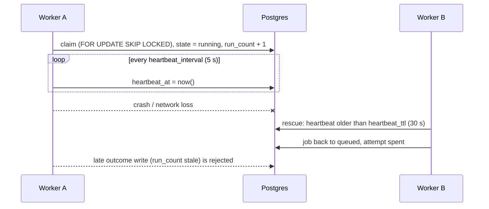

# Delivery and the worker

## At least once

A job can run more than once. The usual cause is a worker that disappears mid-run: another worker sees its heartbeat expire, puts the job back and spends an attempt. Make tasks idempotent, as you would with Celery's `acks_late`, and size `max_attempts` for crashes too. A task that must not run twice (a charge, an SMS) needs an idempotency key in your own tables, and `max_attempts=1` if a second run is worse than no run.

## The lease

Every claim increments the row's `run_count`. A worker writes an outcome only while the row still carries the `run_count` it claimed with, so a worker that comes back after its job was rescued cannot overwrite the new run.

## The worker loop

Each loop the worker heartbeats, rescues jobs of dead workers, prunes old rows (about once a minute), enqueues due schedule fires and claims up to its free slots per queue.

A claim that fills every free slot is followed by another claim immediately. When every slot of a queue is taken, the worker claims again as soon as one of those runs ends, without waiting for the poll. Otherwise the worker waits up to `poll_interval` (1 second), at least half of it, with jitter so idle workers do not poll in step.

| `Worker(...)` option | Default |
|---|---|
| `queues` | `["default"]` |
| `slots` | 1 (per queue) |
| `heartbeat_interval` | 5 s |
| `heartbeat_ttl` | 30 s |
| `poll_interval` | 1 s |
| `shutdown_timeout` | 10 s |
| `fair` | `False` |

## Shutdown

On Ctrl-C or SIGTERM the worker takes no new jobs and waits up to `shutdown_timeout` for running ones. Whatever is still running goes back to the queue without spending an attempt. A synchronous task's thread is not stopped.

## Database errors

!!! note
    This section describes 0.6.0. In 0.5.0 a database error stops the worker.

A transient error (connection loss, server restart or failover, too many connections, a deadlock, a serialization failure) is logged and retried with backoff. The worker keeps running and does not claim while its heartbeat fails. Other database errors, such as a schema that was not migrated, stop it.

If no heartbeat succeeds for `heartbeat_ttl`, the worker stops and puts its unfinished jobs back without spending an attempt. If the database is still unreachable, another worker rescues them once their heartbeat expires, which spends an attempt like any lost run. `akadze worker` then exits with code 1.

If writing a run's outcome fails transiently, the worker retries the same outcome while it still owns the job; the job is not run again. An outcome that cannot be stored at all (for example a NUL character in the result) ends the job `failed` without new attempts.
