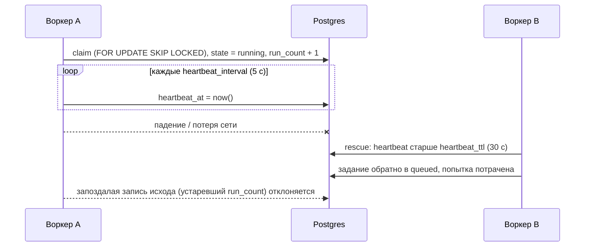

# Доставка и воркер

## At least once

Задание может выполниться больше одного раза. Обычная причина — воркер пропал посреди запуска: другой воркер видит, что его heartbeat истёк, возвращает задание в очередь и тратит попытку. Делайте задачи идемпотентными, как с `acks_late` в Celery, и закладывайте `max_attempts` и на падения. Задаче, которую нельзя выполнить дважды (списание, SMS), нужен ключ идемпотентности в ваших таблицах, а если второй запуск хуже, чем никакого, — `max_attempts=1`.

## Аренда

Каждый claim увеличивает `run_count` строки. Воркер записывает исход, только пока в строке тот `run_count`, с которым он её забрал, поэтому вернувшийся воркер, чьё задание уже подобрали, не перезапишет новый запуск.

## Цикл воркера

На каждом круге воркер отправляет heartbeat, подбирает задания мёртвых воркеров, чистит старые строки (примерно раз в минуту), ставит наступившие запуски расписаний и забирает задания на свободные слоты в каждой очереди.

Если claim занял все свободные слоты, следующий claim идёт сразу. Когда заняты все слоты очереди, воркер делает claim, как только завершается одно из этих заданий, не дожидаясь опроса. Иначе воркер ждёт до `poll_interval` (1 секунда), не меньше половины, с джиттером, чтобы простаивающие воркеры не опрашивали базу синхронно.

| Параметр `Worker(...)` | По умолчанию |
|---|---|
| `queues` | `["default"]` |
| `slots` | 1 (на очередь) |
| `heartbeat_interval` | 5 с |
| `heartbeat_ttl` | 30 с |
| `poll_interval` | 1 с |
| `shutdown_timeout` | 10 с |
| `fair` | `False` |

## Остановка

По Ctrl-C или SIGTERM воркер перестаёт брать задания и ждёт выполняющиеся до `shutdown_timeout`. Всё, что не успело, возвращается в очередь без траты попытки. Поток синхронной задачи не останавливается.

## Ошибки базы

!!! note
    Раздел описывает 0.6.0. В 0.5.0 ошибка базы останавливает воркер.

Транзиентная ошибка (потеря соединения, рестарт или failover сервера, слишком много соединений, deadlock, ошибка сериализации) пишется в лог и повторяется с backoff. Воркер продолжает работу и не делает claim, пока heartbeat не проходит. Другие ошибки базы, например непримененная схема, его останавливают.

Если heartbeat не проходит дольше `heartbeat_ttl`, воркер останавливается и возвращает незавершённые задания в очередь без траты попытки. Если база всё ещё недоступна, их подберёт другой воркер, когда истечёт heartbeat; это тратит попытку, как любой потерянный запуск. `akadze worker` тогда завершается с кодом 1.

Если запись исхода запуска упала с транзиентной ошибкой, воркер повторяет запись того же исхода, пока владеет заданием; само задание заново не выполняется. Исход, который сохранить нельзя вообще (например, символ NUL в результате), завершает задание в `failed` без новых попыток.
