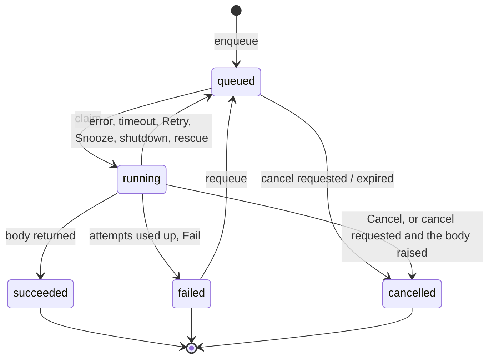

# Job states

A job is a row in `akadze.jobs`. Its `state` is one of five values.

| State | Meaning |
|---|---|
| `queued` | waiting; ready once `run_at` has passed |
| `running` | claimed by a worker that holds the lease |
| `succeeded` | the body returned a JSON value (or nothing); `result` holds it |
| `failed` | out of attempts, or `Fail`; `errors` holds the latest failures (the last 10 run errors, plus lost-worker entries) |
| `cancelled` | cancelled before or during a run |

Finished rows are deleted after the app's `retention` (default 7 days).

Useful columns: `attempt` (attempts spent), `max_attempts`, `run_count` (claims so far, used for fencing), `snoozes`, `run_at`, `priority`, `unique_key`, `limit_key`, `meta`, `worker_id`, `cancel_requested_at`, `expires_at`, `finished_at`.
