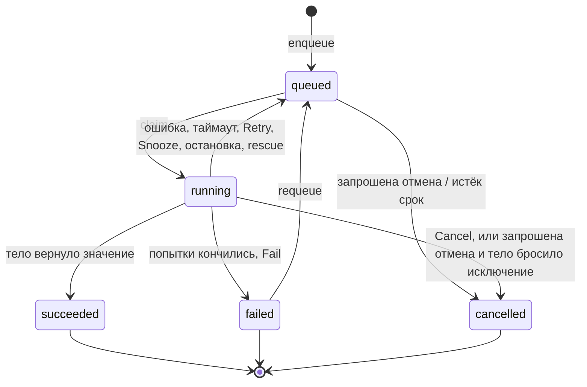

# Состояния задания

Задание — строка в `akadze.jobs`. Его `state` принимает одно из пяти значений.

| Состояние | Смысл |
|---|---|
| `queued` | ждёт; готово, когда наступил `run_at` |
| `running` | забрано воркером, который держит аренду |
| `succeeded` | тело вернуло JSON-значение (или ничего); оно в `result` |
| `failed` | попытки кончились или `Fail`; в `errors` последние сбои (до 10 ошибок запусков плюс записи о потерянных воркерах) |
| `cancelled` | отменено до запуска или во время него |

Завершённые строки удаляются через `retention` приложения (по умолчанию 7 дней).

Полезные колонки: `attempt` (потраченные попытки), `max_attempts`, `run_count` (сколько раз задание забирали, используется для fencing), `snoozes`, `run_at`, `priority`, `unique_key`, `limit_key`, `meta`, `worker_id`, `cancel_requested_at`, `expires_at`, `finished_at`.
